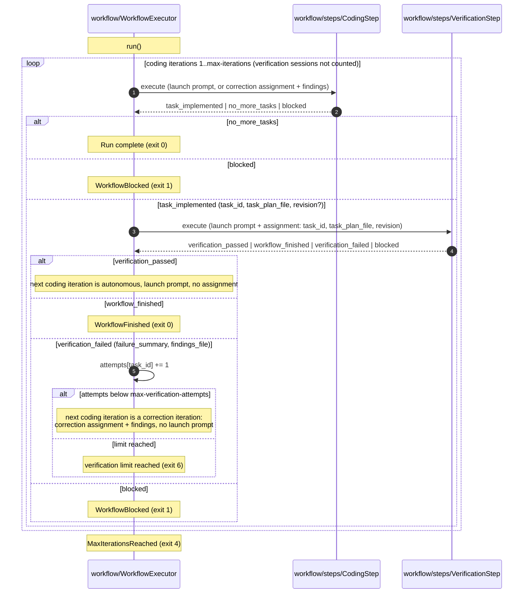

# Workflow execution flow

How `WorkflowExecutor` runs the coding and verification steps. This is the two-phase loop proposed by
[add-verification-stage.spec.md](../../specs/add-verification-stage.spec.md), not the current code.
`VerificationStep` is a working name for the second `WorkflowStep`. The CLI, the reporter, the session layer and the
agent adapters are left out.

In either phase, an execution error or contract violation is retried once with a new nonce and the same prompt; a
second consecutive one ends the run (exit 3). A timeout (exit 5) or an interrupt (exit 130) ends the run immediately.
